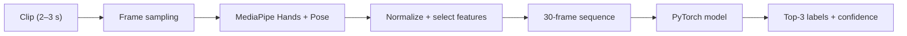
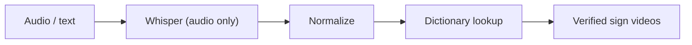

# VACHIKA — AI Model

## 1. Goal

Recognize a small set of **isolated ISL signs** from short video clips, served by the backend. Continuous sentence-level translation is a future goal and must not be claimed for the MVP.

## 2. Pipelines

**Sign → Text (server-side)**



**Speech/Text → Sign**



Training and serving share the same preprocessing code, so the two cannot drift apart.

## 3. Dataset

Candidates: iSign, ISLTranslate, ISLRTC dictionary, Amrita resources. Before use, check:
- Authentic ISL, signer count and diversity, video quality, lighting, annotations
- **Licence and permitted use**, including training and redistributing a derived model

Rules:
- Fix a consistent label map; remove corrupt and duplicate clips.
- Keep signer IDs and record source and licence per clip.
- Have an ISL-literate person validate the 20 chosen labels.
- If public data is insufficient, record a small custom set (multiple signers, varied lighting and angles) with consent.

**Splits are by signer**: no signer appears in more than one of train, validation and test.

## 4. MVP vocabulary

- 20 signs with reliable, varied examples (greetings, yes/no, basic needs)
- Plus a **"no_sign"** class (idle hands, random movement) so the model can say "nothing recognised"
- Expand only after the MVP target is met

## 5. Features

| Item | Decision |
|---|---|
| Landmarks | Left hand 21, right hand 21 (x, y, z) |
| Pose subset | nose, shoulders, elbows, wrists (7 landmarks, x, y, z) |
| Face | Not used in v1 |
| Feature size | **F = 147** (126 hand + 21 pose) |
| Normalization | Translate to shoulder midpoint; scale by shoulder width |
| Missing hand | Fill with zeros |
| Sequence | Resample to **30 frames**; input shape `(batch, 30, 147)` |
| Order | Fixed order documented in code and unit-tested |

Sequence length and features may be tuned by experiment; any change updates the preprocessing code used by both training and serving.

## 6. Models

| Model | Role |
|---|---|
| BiLSTM | Baseline |
| TCN | Faster alternative |
| Transformer | Optional, only if the others underperform |

Train all with identical splits and metrics. Choose by unseen-signer accuracy, latency and size.

## 7. Training

- Stack: Python, PyTorch, NumPy, OpenCV (clips), MediaPipe, TensorBoard. Colab or a local GPU.
- Cross-entropy loss, Adam, early stopping on validation F1.
- Augmentation that preserves meaning: small shifts and scale, light noise, speed jitter, random frame dropout. No horizontal flip unless it is confirmed not to change sign meaning.
- Save config, seed, checkpoint and metrics for every run.

## 8. Evaluation

| Metric | Why |
|---|---|
| Accuracy, precision, recall, F1 | Overall and per-class |
| Confusion matrix | Find confused signs |
| Inference latency | Must fit the ≤ 3 s end-to-end target |

Test conditions: unseen signers, different lighting, camera distance, speed, background, partial hand visibility.

**MVP target:** ≥ 80% accuracy on unseen signers. Report failure cases honestly.

## 9. Serving

- FastAPI loads the model and MediaPipe once at startup.
- `POST /api/v1/sign/recognize` accepts a clip within size/duration limits, returns top-3 labels and confidence.
- **Confidence rule:** below the threshold (tuned on validation data), or when "no_sign" wins, the app shows "uncertain, please retry". Predictions are never presented as confirmed.
- Clips are processed in memory and deleted. Nothing is logged or stored.
- Start with CPU inference; export to ONNX only if latency needs it.
- Model files are versioned; the API returns the model version.

## 10. Speech and text-to-ISL

- **ASR:** Whisper server-side for English, Hindi and Marathi. Benchmark `small` vs `medium` (accuracy, latency) on Hindi/Marathi before choosing; AI4Bharat Indic models are the fallback.
- **TTS:** Android native via `flutter_tts`.
- **Text-to-ISL (v1):** normalize → tokenize/lemmatize → dictionary lookup per word/phrase → ordered sign videos. Unknown words are reported as unavailable. This is not full ISL grammar translation.
- **Sign label → text:** each sign has en/hi/mr text in the `signs` table.

## 11. Sign dictionary

Fields: `sign_id`, labels (en/hi/mr), `gloss`, `category`, `video_url`, `verified`, `region`. Video source must be decided early: ISLRTC with written permission, or self-recorded with an ISL signer.

## 12. Repository layout

```text
ai_model/
├── datasets/ (raw, processed, labels)
├── preprocessing/ (extract_landmarks.py, normalize.py, build_sequences.py)
├── models/ (bilstm.py, tcn.py, transformer.py)
├── training/ (train.py, evaluate.py, config.py)
├── checkpoints/
├── serving/ (shared preprocessing + inference used by the backend)
└── tests/ (feature order, shapes, preprocessing parity)
```

## 13. Stages

1. Dataset choice, licence check, 20-sign list
2. Landmark extraction and sequence building
3. Train and compare models
4. Evaluate on unseen signers, tune the confidence threshold
5. Serve through FastAPI and connect to the app
6. Expand the vocabulary; explore continuous recognition

## 14. Key cautions

1. MediaPipe extracts landmarks; it does not recognize signs.
2. Hand shape alone is not sign recognition, so movement matters.
3. Facial expression and posture can carry grammar, and v1 ignores them.
4. Accuracy on seen signers is not accuracy on new people, so always split by signer.
5. Validate with Deaf ISL users, not only metrics.
6. Check dataset licences before deployment.

**VACHIKA — Every Expression Deserves a Voice.**
