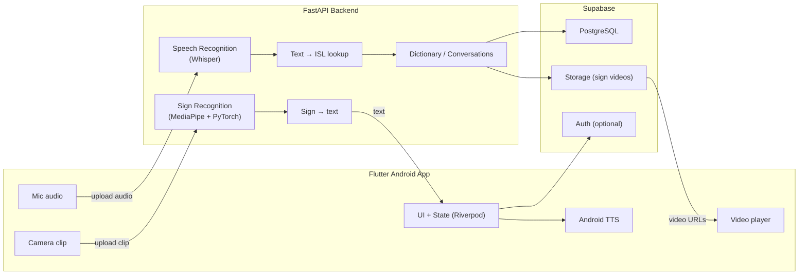

# VACHIKA — System Architecture

## 1. Overview

A client–server design. The **Flutter Android app** captures camera, microphone and text input and shows results. The **FastAPI backend** runs all AI (sign recognition, speech recognition, text-to-ISL) and serves the sign dictionary. **Supabase** stores data and sign videos. The app requires internet.



## 2. Flutter app

| Concern | Choice |
|---|---|
| State / routing | Riverpod / GoRouter |
| Camera | `camera` (record 2–3 s clip) |
| Audio | `record` |
| HTTP | `dio` |
| Video | `video_player` |
| TTS | `flutter_tts` (Android native) |
| Backend/Auth | `supabase_flutter` (auth only) |
| Preferences | `shared_preferences` |

```text
vachika/lib/
├── core/        # theme, routing, constants, utils
├── features/    # onboarding, home, sign_to_speech, speech_to_sign,
│                # conversation, dictionary, history, settings
├── data/        # models, repositories, api client
└── main.dart
```

Min Android SDK 24. All styling comes from `core/theme` (see `DESIGN.md`).

## 3. Sign → Speech flow

1. App records a 2–3 s clip and uploads it (`POST /api/v1/sign/recognize`).
2. Backend extracts frames, runs MediaPipe Hands + Pose, builds the feature sequence (see `AI_MODEL.md`), runs the model.
3. Backend returns top-3 labels with confidence.
4. App shows the top result (or "uncertain" below the threshold), lets the user confirm, retry or correct.
5. Confirmed sign label → text in the chosen language (`gloss-to-text`, a label-to-text lookup in v1) → spoken with Android TTS.

The clip is processed in memory and deleted. It is not stored.

## 4. Speech → Sign flow

1. App uploads audio (`POST /api/v1/speech/transcribe`) or the user types text.
2. Backend runs Whisper and returns an editable transcript.
3. Text-to-ISL (v1): normalize → tokenize → look up each word/phrase in the sign dictionary → ordered list of sign records with video URLs.
4. App plays the videos in sequence with replay, pause and speed controls.
5. Words with no verified sign are shown as "sign unavailable". They are never replaced with unrelated videos.

Word-for-word lookup is an MVP simplification, not full ISL grammar, and the UI must say so.

## 5. Conversation Mode

Turn-based on one phone; only one input (camera or mic) is active at a time.

- **Hearing turn:** speak → transcript → sign videos for the Deaf participant.
- **Deaf turn:** sign clip → recognized text → optional speech for the hearing participant.
- Shared transcript with participant labels, replay, correction, and a visual and haptic turn indicator.

## 6. Backend

```text
backend/app/
├── main.py
├── core/        # config, security, limits
├── api/routes/  # health, sign, speech, translation, signs, conversations, feedback
├── services/    # sign_inference, speech, translation, sign_dictionary, conversation
├── schemas/
└── repositories/
```

| Method | Endpoint | Purpose |
|---|---|---|
| GET | `/api/v1/health` | Health check |
| POST | `/api/v1/sign/recognize` | Clip → top-3 labels + confidence |
| POST | `/api/v1/speech/transcribe` | Audio → text |
| POST | `/api/v1/translate/text-to-sign` | Text → sign sequence |
| POST | `/api/v1/translate/gloss-to-text` | Sign label → text (en/hi/mr) |
| GET | `/api/v1/signs`, `/signs/{id}` | Dictionary |
| POST/GET | `/api/v1/conversations`, `/{id}` | Conversation records |
| POST | `/api/v1/feedback` | Corrections |

Schemas are defined in `API.md`. Models load once at startup. Limits: max upload size and duration, rate limiting per client.

## 7. Data

| Table | Purpose |
|---|---|
| `users` | Optional account and preferences |
| `signs` | sign_id, labels (en/hi/mr), gloss, category, video_url, verified |
| `sign_variants` | Verified regional variants |
| `conversations`, `messages` | Optional history |
| `feedback` | User corrections |

Supabase Storage holds verified sign videos. Row-level security protects user-specific data.

## 8. Security and privacy

- HTTPS only; secrets in environment variables, never in source.
- Camera/mic permissions requested only when needed.
- Uploaded clips and audio are processed in memory and deleted; never logged or stored.
- Auth is optional for the MVP (anonymous use, login for history).
- History is opt-in and deletable.

## 9. Deployment

- Backend runs in Docker on a CPU server first; move to GPU only if Whisper latency requires it. Host to be decided.
- Models are versioned and loaded from disk or storage at startup.
- CI: lint and tests on the backend and Flutter app.

## 10. Constraints

- Accuracy depends on dataset quality, signer diversity and lighting.
- The app needs a stable connection; slow networks raise latency.
- Dictionary coverage limits speech → sign output.
- Isolated signs are not sentences. The UI must not imply otherwise.

**VACHIKA — Every Expression Deserves a Voice.**
